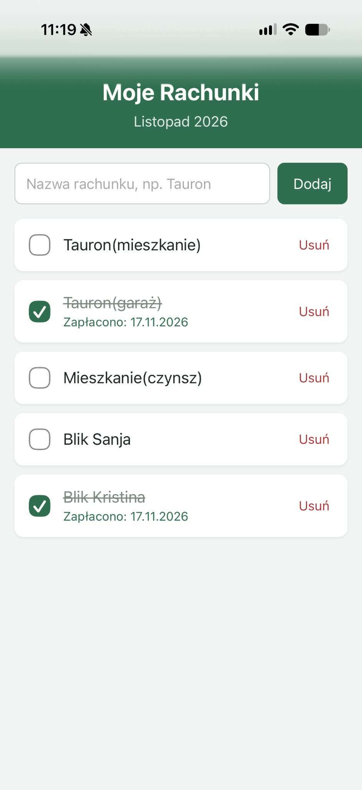

# Moje Rachunki – aplikacja PWA

🔗 **Wersja online:** https://krslowik.github.io/myBills-PWA/

<p align="center">
  
</p>

Prosta aplikacja PWA do kontrolowania stałych miesięcznych rachunków.
Użytkownik tworzy listę rachunków (np. Tauron, czynsz, internet) i co miesiąc
odhacza te, które zapłacił. Przy zapłaconej pozycji wyświetla się data zaznaczenia.
Z początkiem nowego miesiąca wszystkie rachunki są ponownie niezapłacone.

## Funkcje

- dodawanie i usuwanie rachunków,
- zaznaczanie „zapłacone” z zapisaniem daty zapłaty,
- osobny stan dla każdego miesiąca (automatyczny „reset” w nowym miesiącu),
- zapis danych w pamięci urządzenia (`localStorage`) – bez serwera i bazy danych,
- działanie offline (Service Worker, strategia cache-first),
- możliwość instalacji na telefonie i komputerze (Web App Manifest).

## Struktura plików

| Plik                           | Opis                                                |
| ------------------------------ | --------------------------------------------------- |
| `index.html`                   | struktura aplikacji                                 |
| `style.css`                    | wygląd, układ responsywny                           |
| `main.js`                      | logika aplikacji i rejestracja Service Workera      |
| `sw.js`                        | Service Worker – cache plików, działanie offline    |
| `manifest.json`                | opis aplikacji do instalacji (nazwa, ikony, kolory) |
| `icon-192.png`, `icon-512.png` | ikony aplikacji                                     |

## Uruchomienie

Funkcje PWA (Service Worker, instalacja) działają tylko przez `https://` lub `localhost`.
Otwarcie pliku `index.html` dwuklikiem (`file://`) nie uruchomi Service Workera.

**Sposób 1 – VS Code:** zainstalować rozszerzenie _Live Server_, otworzyć folder
projektu, kliknąć prawym przyciskiem na `index.html` → _Open with Live Server_.

**Sposób 2 – terminal** (w folderze projektu):

```
npx serve .
```

a następnie otworzyć w przeglądarce `http://localhost:8000` (lub adres podany przez `serve`).

## Instalacja na telefonie

Otwórz https://krslowik.github.io/myBills-PWA/ na telefonie, a następnie:
 

- **Android (Chrome):** menu ⋮ → _Zainstaluj aplikację_ / _Dodaj do ekranu głównego_,
- **iPhone (Safari):** _Udostępnij_ → _Do ekranu początkowego_.
